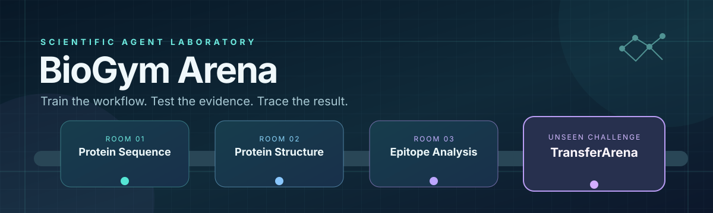

  

<h1 align="center">BioGym Arena</h1>

<strong>A training and evaluation laboratory for bioinformatics AI agents.</strong>

  
  
  

  <a href="#the-problem">The problem</a> ·
  <a href="#who-it-is-for">Who it is for</a> ·
  <a href="#what-we-plan-to-build">The plan</a> ·
  <a href="#evaluation">Evaluation</a> ·
  <a href="#related-research">Research</a>

## Project status

BioGym Arena is a **documentation-first project proposal**. This repository does not yet contain a running OpenEnv environment, trained agent, TransferArena evaluation, frontend, or measured results. The sections below describe the intended product and evaluation protocol, not implemented capabilities.

## The problem

An MCP server can give an AI agent scientific tools. Tool access alone does not tell us whether the agent chooses appropriate tools, recovers from failures, preserves provenance, or draws conclusions supported by the returned evidence. An agent may complete a workflow yet still mishandle a corrupted input or misleading result.

[BioAgent Bench](https://proceedings.mlr.press/v306/fa26a.html) reports failures under controlled bioinformatics perturbations despite agents' ability to construct multi-step pipelines. [BixBench](https://arxiv.org/abs/2503.00096) evaluates open-ended computational biology analysis, while [BiomniBench](https://www.biorxiv.org/content/10.64898/2026.05.12.724604v2) studies evaluation of agents' analytical processes. These works motivate careful agent evaluation; BioGym Arena does not claim to have invented bioinformatics agent benchmarks or reinforcement-learning environments.

**Our question:** can repeatable scientific episodes, explicit evidence checks, and held-out transfer tasks help us measure and improve the reliability of bioinformatics agents?

## Who it is for

| User | Job BioGym Arena should help with |
| --- | --- |
| Scientific agent developers | Test agent policies and tool integrations before supervised research use; compare versions under the same conditions. |
| Bioinformatics and computational biology teams | Inspect an agent's decisions, evidence trail, failures, and reproducible run package. |
| AI evaluation and training researchers | Develop episodes and reward rubrics, test generalization, and study whether policy updates improve held-out performance. |
| Educators and learners | Practice valid scientific tool use and evidence interpretation in controlled scenarios. |

The initial scope is **protein sequence, protein structure, and epitope analysis**. The wider set of scientific domains is a roadmap, not current coverage.

## What we plan to build

### Scientific rooms and training modes

The frontend is conceived as a connected laboratory. A moving floor guides visitors between **scientific rooms**; each room contains sessions made up of replayable episodes. Direct navigation remains available for inspection.

| Initial room | Example tasks |
| --- | --- |
| Protein Sequence | Validate FASTA input, maintain sequence identity, and select appropriate sequence operations. |
| Protein Structure | Retrieve and validate structures and chains; distinguish predicted from experimental structural evidence. |
| Epitope Analysis | Execute bounded immunoinformatics workflows and qualify claims against the available evidence. |

Each room can host reusable **training modes**: ToolGym (tool selection), PipelineGym (multi-step execution), ChaosGym (fault recovery), EvidenceGym (evidence assessment), and, later, ResearchGym (adaptive planning). These are modes within rooms, not separate scientific datasets. The longer-term room roadmap also includes DNA, RNA-seq, variants, gene expression, metagenomics, docking, and drug-discovery workflow validation.

Every episode can measure two complementary skills:

- **LabOps:** valid execution, workflow planning, recovery, reproducibility, and resource use.
- **ResearchSense:** provenance assessment, uncertainty, evidence-supported conclusions, and justified abstention.

They share an episode and may both be tested by one challenge. Evaluation reports keep their measurements separate so operational success cannot conceal poor scientific judgment.

### Shared environment and scientific tools

The planned runtime follows [Hugging Face OpenEnv](https://huggingface.co/docs/openenv/index): an agent receives observations, takes actions through an episode interface, and receives environment-side rewards. A **harness** controls permitted actions and budgets; a **loop** advances actions, observations, and rewards; an **execution graph** records dependencies and evidence lineage.

[ImmunoGraph MCP](https://github.com/Ajey95/immuno-graph) is the proposed first scientific tool layer. Its [tool catalog](https://github.com/Ajey95/immuno-graph/blob/main/docs/TOOL_CATALOG.md) covers sequence validation, immune prediction, evidence and ranking, structure, chemistry, docking, and exports. Its tools distinguish configured live results from fixtures and synthetic demonstrations. BioGym Arena would add episodes, independent grading, agent trajectories, and transfer evaluation around those calls. The 46 MCP tools are **not** 46 independent live data providers; availability depends on configuration and external runtimes. See ImmunoGraph's [execution reality matrix](https://github.com/Ajey95/immuno-graph/blob/main/docs/TOOL_REALITY_MATRIX.md).

### TransferArena and visual replay

**TransferArena is part of the initial demonstration plan.** It evaluates an agent on an unseen task after controlled room episodes, with source status and evaluation conditions visible. The initial demo targets at least one live scientific service. Recorded, versioned inputs are also needed for repeatable comparisons when external records or availability change; replayed data must not be labelled live.

The planned interface synchronizes:

- a 3D molecular view using coordinates relevant to the active episode;
- a live tool and evidence graph;
- a timeline that can pause, scrub, and replay decisions and failures;
- step-level rewards with explanations and LabOps / ResearchSense scorecards;
- clickable provenance from source record through tool result to agent claim.

An **Evaluation Hall** would compare a baseline with a later policy or configuration on the same held-out tasks. A completed run would offer a downloadable ZIP with its inputs, configuration, actions, observations, tool outputs, source snapshots, reward breakdown, molecular artifacts where applicable, report, and integrity manifest. Secrets and private credentials must be excluded from exports.

Sarvam AI is a proposed baseline agent for tool-use episodes; Smallest.ai is planned for spoken replay; Devin is the planned development assistant for the hackathon. None of these integrations is present yet.

## Evaluation

We intend to publish **measured outcomes with their denominators and conditions**, not a single opaque score. An episode rubric should distinguish checkable task completion from the scientific interpretation of that completion.

| Measure | What it asks |
| --- | --- |
| Task success | Did the agent produce the specified, verifiable artifact or decision? |
| LabOps reliability | Were tool inputs valid, dependencies respected, and failures recovered without invented output? |
| Evidence integrity | Were sources and `LIVE`, `FIXTURE`, or `SYNTHETIC` statuses represented correctly? |
| ResearchSense judgment | Were claims supported, uncertainty stated, and abstention used when warranted? |
| Efficiency | How many tool calls, how much elapsed time, and what service cost did the task require? |
| Transfer performance | How did the agent perform on held-out and unseen tasks relative to its controlled-room results? |

For a before/after claim, the comparison should use held-out tasks, the same task definitions, tool access, budgets, and scoring rules, repeated episodes, and an identified baseline. The report should include the number of cases, per-task outcomes, reward definitions, model or configuration versions, episode seeds, source snapshots, and uncertainty appropriate to the sample size. The run package should preserve the evidence required to inspect a disputed result. Live sources can change; a saved snapshot supports replay, while a fresh live rerun may produce different data.

**“After training” is reserved for an actual policy update.** An OpenEnv-compatible episode supplies actions, observations, and rewards; it does not itself change model weights. Until a trainable model and trainer are connected, any comparison will be labeled **baseline vs. revised configuration** or **agent A vs. agent B**. [TRL's OpenEnv integration](https://huggingface.co/docs/trl/openenv) documents one possible path to policy training.

## Scientific boundaries

BioGym Arena is intended for computational research and agent evaluation. A tool call, epitope prediction, docking pose, confidence score, or successful episode does not establish experimental binding, vaccine efficacy, safety, or clinical validity. Fixtures and synthetic exercises must remain visibly distinct from live scientific results. Expert review and experimental validation are outside an automated episode score.

## Related research

| Work | Relevance to this project |
| --- | --- |
| [BioAgent Bench (ICML 2026)](https://proceedings.mlr.press/v306/fa26a.html) | End-to-end bioinformatics tasks and robustness under controlled perturbations. |
| [BixBench (2025)](https://arxiv.org/abs/2503.00096) | Open-ended analysis of real computational biology scenarios. |
| [BixBench3 (2026 preprint)](https://arxiv.org/abs/2608.25286) | Research-study-scale tasks using raw biological data and multi-step analyses. |
| [BiomniBench (2026 preprint)](https://www.biorxiv.org/content/10.64898/2026.05.12.724604v2) | Process-level assessment of biomedical research agents. |

These are related efforts and research context, not BioGym Arena results or endorsements.

## Architecture diagrams

<!-- Reserved for diagrams grounded in an implemented and reviewed architecture. -->

## Results

<!-- Reserved for measured runs and reproducible evaluation artifacts. -->

## Contributing

This repository currently contains the project proposal and community files. Documentation corrections and research references are welcome; see [CONTRIBUTING.md](CONTRIBUTING.md). Please use [SECURITY.md](SECURITY.md) for security reports.

## License

MIT. See [LICENSE](LICENSE).
