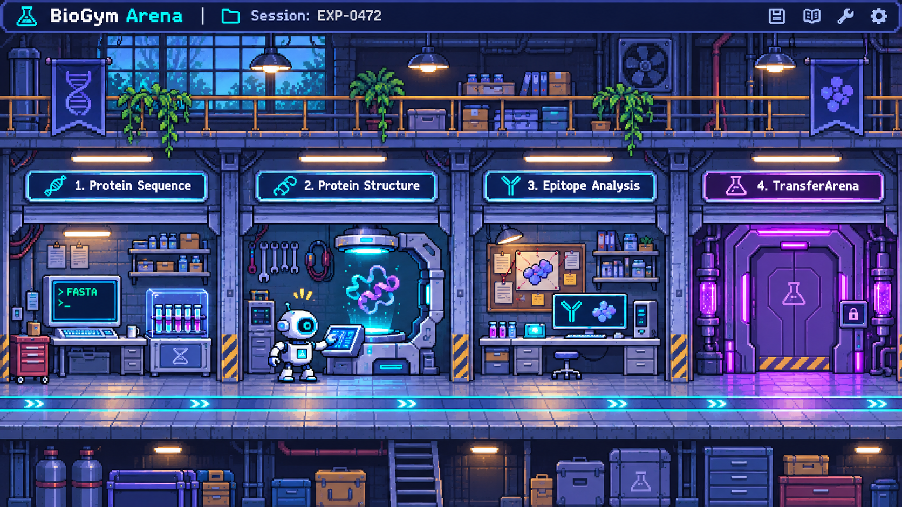
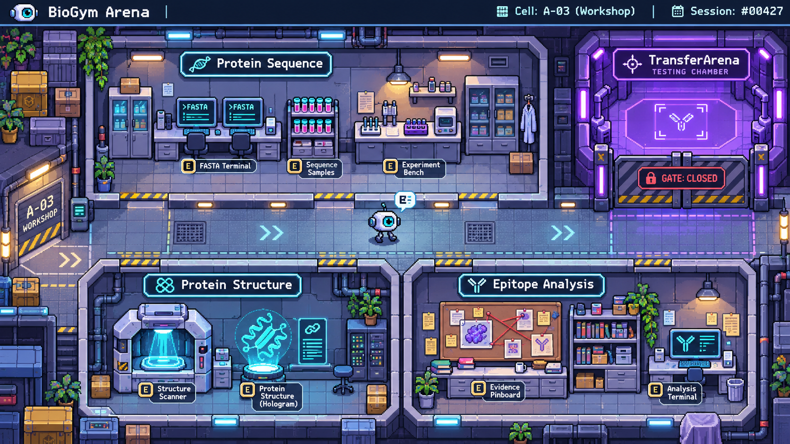

# 2D garage-world exploration

These are **visual options**, not application screenshots or a selected frontend design. They respond to the request for a real 2D pixel game world where a small robot moves among laboratory garage bays and their equipment. The previous pixel-styled dashboard boards remain separate references for inspection panels and evaluation details.

## Option A: side-view garage bays

The robot occupies the same visible floor as the lab workbenches. Each scientific room has a distinct bay, with its own stored tools and active equipment. This makes a station-by-station traversal easy to follow during a judge demo.

## Option B: top-down workshop map

The robot travels through a navigable map and enters rooms to use specific workbenches. This makes room exploration, collectibles/artifact storage, and route choices more explicit.

## Interaction model common to both

- The robot is the visual representation of the agent, not a separate game character making independent scientific decisions.
- A workbench corresponds to a real episode action: choose a tool, inspect a result, check evidence, recover from a fault, or submit a conclusion.
- Interacting with a station opens a focused overlay for tool arguments, outputs, provenance, rewards, or a relevant molecular structure. The world remains the main visual context.
- TransferArena is a distinct room for the unseen challenge. Evaluation Hall and the downloadable run ZIP remain available from the run record.
- During replay, the robot follows recorded action timestamps and pauses at failures, evidence checks, and decisions. Without a recorded episode, the scene must be labelled as a concept or demonstration.

The exact prompts used with the built-in image generation tool are in [image-prompts.md](../image-prompts.md).
