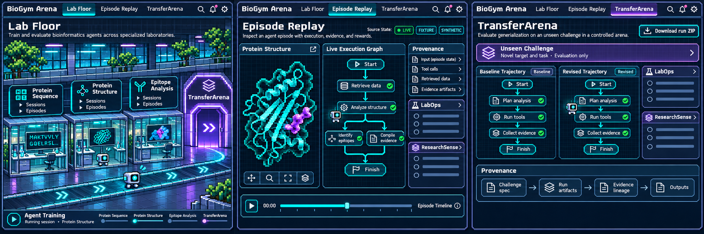
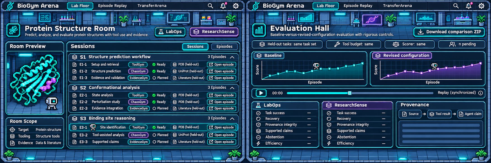
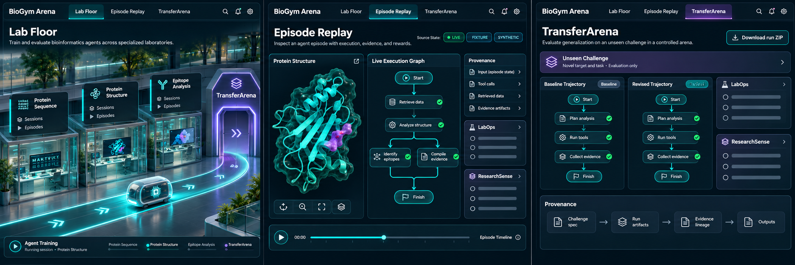
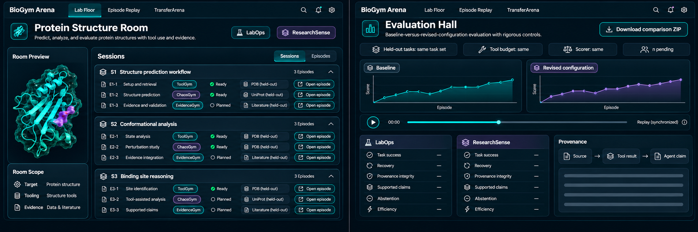

# Frontend visual reference

These boards show the intended **BioGym Arena experience**, not screenshots of a working application or measured evaluation results. Session names, episode statuses, trajectories, charts, and molecular imagery are illustrative design content. Product data must come from recorded episodes and scientific artifacts when the frontend is built.

**Selected direction:** the [top-down laboratory world](top-down-flow/README.md) is the current frontend design. The earlier [2D garage-world options](explorations/garage-view-options.md) and the boards below remain references for information layout and inspection panels.

## Pixel-art direction (current)

The revised direction uses crisp pixel-art rooms and a small robot agent. The robot travels along the lab floor, moves within the active scientific cell, and appears as the agent marker in replay and TransferArena. The [animated motion study](robot-motion-study.svg) demonstrates the visual rhythm. It is a looping design asset, not a frontend implementation or a recording of a real agent.





## Earlier visual direction





## Product journey

```text
Lab Floor → Scientific Room → Session → Episode Replay → TransferArena → Evaluation Hall → Run ZIP
```

The **moving floor** is the navigation metaphor. It visually carries the robot agent past scientific rooms and toward TransferArena. It should never be the only navigation method: room links, breadcrumbs, and keyboard-accessible controls remain available. Reduced-motion preferences should replace travel animations with immediate transitions.

In the pixel-art direction, the robot represents the agent's **recorded state**. Entering a room, walking to a tool station, pausing at a failed action, and moving to a recovery step should correspond to episode events. It must not imply that a scientific action succeeded merely because an animation completed. The moving floor connects rooms; a selected episode can zoom into its own cell for more detailed robot movement.

## Screen contract

| Screen | Primary job | Required visible elements |
| --- | --- | --- |
| Lab Floor | Orient a visitor and launch a scientific room or TransferArena. | Moving track, initial rooms, room status, session entry, distinct TransferArena destination. |
| Scientific Room | Choose a session and episode for one scientific domain. | Domain scope, session list, episode mode and status, LabOps and ResearchSense as integrated skill dimensions. |
| Episode Replay | Inspect what the agent did and why it was scored that way. | Episode objective, relevant 3D artifact, execution graph, evidence inspector, source-state labels, reward explanation, synchronized timeline. |
| TransferArena | Evaluate behavior on an unseen task. | Unseen-task conditions, live or recorded source state, trajectory, provenance, LabOps and ResearchSense outcomes. |
| Evaluation Hall | Assess a baseline against a later policy or configuration. | Task-set and budget controls, sample size, separate skill scorecards, per-task outcomes, synchronized comparison replay, provenance, download. |

The generated first board combines TransferArena and a compact comparison view. The final information architecture gives Evaluation Hall its own page so comparison methods and measured results have enough space.

## Interaction rules

1. Selecting a timeline step highlights the matching execution node, scientific artifact region, tool input/output, provenance path, and reward event.
2. Selecting an evidence item reveals its source, method, version, timestamp, input and output identities, and `LIVE`, `CACHED`, `FIXTURE`, or `SYNTHETIC` status as available.
3. The molecular viewer shows coordinates relevant to the active episode. An episode without a molecular structure shows its appropriate scientific artifact instead.
4. A failed call remains visible in the graph; retry and recovery become new recorded nodes rather than overwriting the failure.
5. Comparison replay uses one shared time control, with independent traces and a clear marker when one agent finishes earlier.
6. Scores explain their rubric and denominator. Empty states remain empty until measured runs exist. The line charts in the concept image are visual placeholders, not BioGym results.
7. “Before training” and “after training” appear only when an actual agent policy update and held-out evaluation exist. Otherwise the labels identify the compared agents or configurations.

## Evaluation and provenance display

LabOps and ResearchSense are **measurement dimensions within each scientific room**, not separate rooms. The Evaluation Hall keeps both visible. It should report task completion, recovery, provenance integrity, supported claims, appropriate abstention, and efficiency with per-task drilldown, sample counts, and comparison conditions. A single overall score must not hide a serious scientific integrity failure.

The inspectable lineage is:

```text
Source record → tool call → result artifact → agent claim → verifier finding → reward
```

The run ZIP should contain task and source snapshots, configuration, model and tool versions, action/observation trace, verifier decisions, reward breakdown, available molecular files, a readable report, and an integrity manifest. Exclude credentials and private tokens. A fresh live rerun can differ from the preserved snapshot and should be displayed as a separate run.

## Visual system

- Dark navy research workspace; cyan/teal for active scientific data; muted violet for TransferArena and comparisons; amber for warnings and failures.
- Dense enough for scientists, with clear hierarchy: objective first, current action second, evidence and metrics available one click away.
- Use motion to explain state changes. Keep replay controls, graph edges, source labels, and score changes readable while animations run.
- Keep source badges and chart labels textual as well as colored. Provide high-contrast focus states and reduced-motion behavior.

## Source prompts

The raster boards were generated and edited with the built-in image generation tool. The final prompts are preserved in [image-prompts.md](image-prompts.md) for visual continuity. Their layout and mood are references; their depicted data is not authoritative. The animated robot motion study is a hand-authored SVG design reference.
