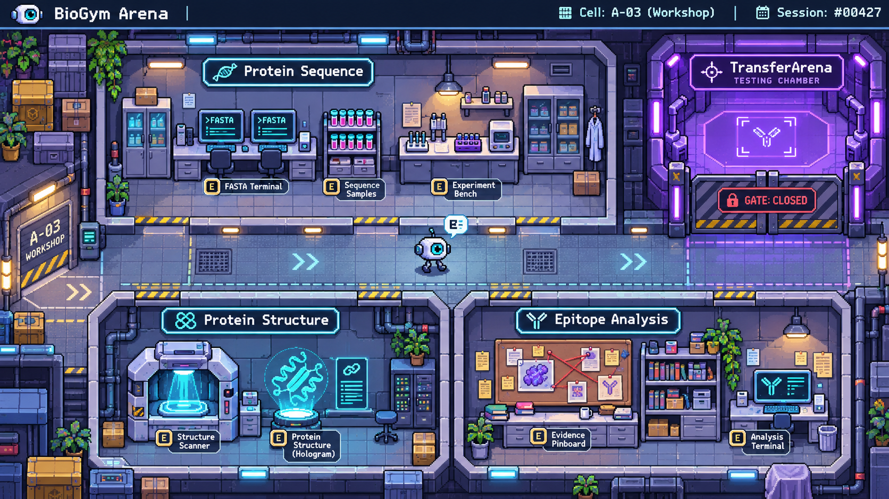
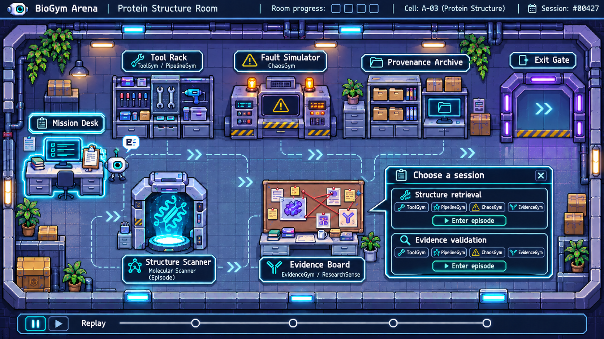
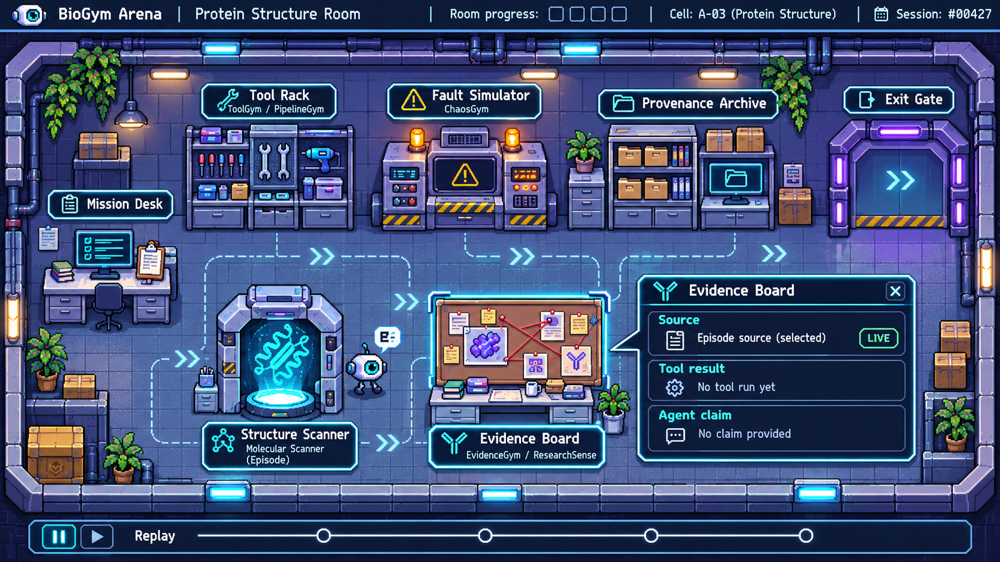
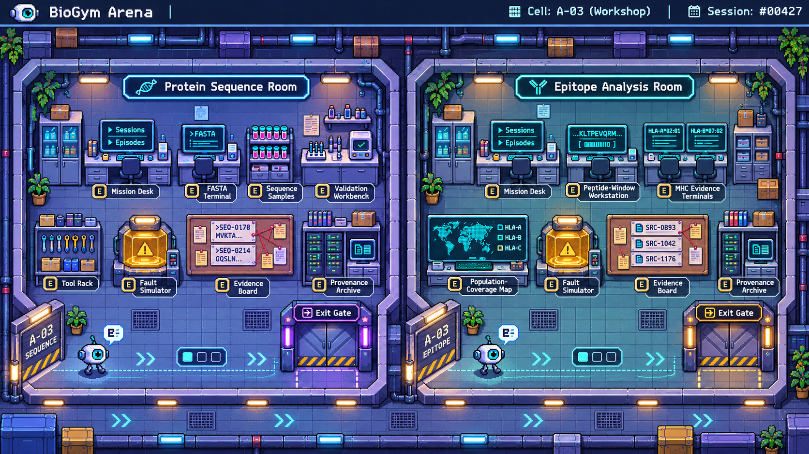
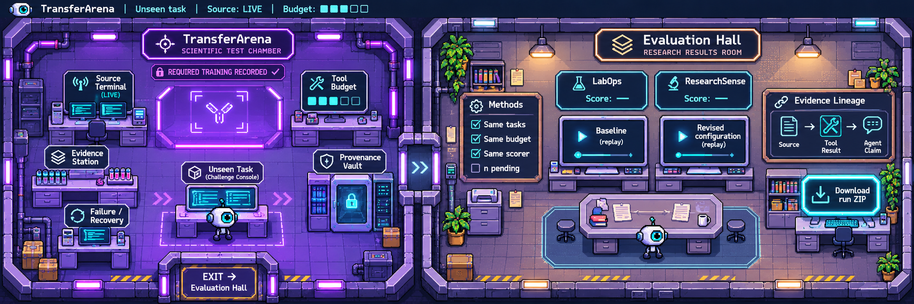

# Selected frontend direction: top-down laboratory world

This is the **selected visual design direction** for BioGym Arena. It is a design reference, not a running frontend or a record of measured agent performance. The screenshots contain illustrative room layouts and placeholders. The [image prompts](prompts.md) are retained for visual continuity.

## Journey

```text
Outer laboratory map
  → enter Protein Sequence Room
  → enter Protein Structure Room
  → enter Epitope Analysis Room
  → final door: TransferArena
  → Evaluation Hall
  → download complete run ZIP
```

The outer world is a **top-down 2D pixel game map**. The small robot represents the agent. Clicking a room door zooms into its interior; the robot enters at the room's entrance tile. A visible return route takes the viewer back to the map. The room can also be reached from a direct navigation menu so game movement never blocks inspection.



## Inside a scientific room

Every room has the same interaction grammar, with domain-specific equipment. The room itself remains visible while focused panels open beside a selected station.

1. **Mission Desk:** choose a session, inspect its required episodes, and start or replay one.
2. **Tool workstations:** the robot moves to domain-relevant tools as the agent calls them. ToolGym and PipelineGym episodes use these stations.
3. **Fault Simulator:** shows injected errors, retries, and recovery branches in ChaosGym episodes.
4. **Evidence Board:** traces source records through tool results to agent claims. EvidenceGym and ResearchSense checks appear here.
5. **Scientific viewer:** opens the relevant sequence, structure, epitope, or other artifact. A 3D molecule viewer opens from a structure station when actual coordinates exist; the surrounding world stays 2D.
6. **Provenance Archive:** inspects methods, versions, source status, hashes, timestamps, and exported artifacts.
7. **Exit Gate:** returns to the outer map after the room's required episodes have been recorded.

LabOps and ResearchSense are **two evaluation dimensions within the episodes**, not separate game rooms. The modes define the kind of challenge; the scientific room defines the domain.

### Mission Desk state



Selecting a session lists its episodes, mode, status, and source requirements. The robot only starts walking toward a workstation after an episode is started or replayed. The four progress boxes in the concept image are placeholders; the product must derive the count from the configured required episodes.

### Evidence inspection state



Selecting an action on the replay timeline focuses the robot's station, the corresponding graph step, the tool result, the evidence trail, and the reward event. A failed action remains visible; recovery adds a new action rather than erasing it. A station click opens inspection data and does not silently execute a scientific tool.

### Other room identities



| Room | Distinct equipment and episode focus |
| --- | --- |
| Protein Sequence | FASTA terminal, sequence samples, validation bench; input and identifier checks. |
| Protein Structure | Structure scanner, chain/coordinate viewer, confidence and evidence inspection. |
| Epitope Analysis | Peptide-window station, immune evidence terminals, population-coverage display, source board. |

The visualized science must come from actual episode inputs and tool results. The room art can be illustrative, but a displayed protein, sequence, map, or claim must not be presented as real run evidence unless it is linked to the recorded artifact.

## Door and progress behavior

- A room's exit opens when all **required episodes have been attempted and recorded**, whether they passed or failed. Optional episodes can remain available. This keeps failures visible and allows a weak agent to be evaluated in TransferArena.
- Room progress distinguishes `not started`, `running`, `completed`, and `failed`; a completed attempt is not automatically a scientific success.
- The **TransferArena door** is the final door on the outer map. It opens once the selected run's required room attempts are recorded. If a run is incomplete, the door identifies the missing episode rather than showing an unexplained lock.
- After the TransferArena episode is recorded, its exit leads to **Evaluation Hall**. Evaluation Hall remains accessible later from the run archive.
- During a judge replay, the same door logic is driven by the saved run events. Replay never invents a success to advance the story.

## TransferArena and Evaluation Hall



**TransferArena** is an unseen task with its own source-status display and tool budget. The robot performs the task through the same action/observation interface used in the rooms. The source terminal shows whether the result is live, cached, fixture, or synthetic. Held-out task answers are not exposed through room decorations or hints.

**Evaluation Hall** is a room for inspecting measured outcomes. LabOps and ResearchSense have separate scoreboards. A methods station displays the task set, model/configuration versions, budgets, scorer version, number of attempts, and uncertainty when justified. Baseline and later runs have synchronized replay stations and per-task drilldown. An evidence wall traces source → tool result → claim → verifier finding → reward. The ZIP terminal exports the run's task/configuration, action trace, source snapshots, artifacts, rewards, integrity manifest, and evaluation report without credentials.

The room labels a comparison **before/after training** only if an actual policy update occurred and held-out evaluation supports that claim. Otherwise it names the specific agents or configurations being compared. Blank scoreboards remain blank until real runs exist. The illustrated images are not results.

## Motion and accessibility

- Robot movement follows recorded agent events and timestamps: enter, walk to station, act, pause for output, react to error, recover, or exit.
- Viewers may pause, scrub, slow down, or jump to an event. Robot position, focused station, graph, evidence panel, and timeline stay synchronized.
- Reduced-motion mode uses immediate position changes and preserves all event information. Keyboard and direct navigation provide access without moving through the map.
- Source status and outcomes use text and icons as well as color.

No application code or RL training is implemented by these design references.
